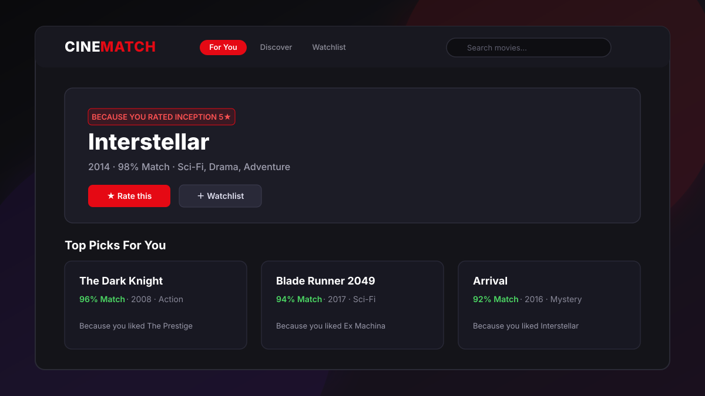

# CineMatch 🎬



A hybrid movie recommendation web app. Rate movies → get personal picks with
explanations ("Because you rated Inception 5★"), live match percentages, mood
and genre filters, search, and a watchlist.

**Stack:** Python · Flask · Pandas · scikit-learn · vanilla JS (no build step)

## How the engine works

Two models are precomputed offline over **MovieLens ml-latest-small**
(100,836 ratings · 9,742 movies · 610 users):

| Model | Technique | Weight |
|---|---|---|
| Collaborative | Item-item cosine similarity over mean-centered user ratings (sparse matrix) | 0.80 |
| Content-based | TF-IDF over genres (3×) + user tags, cosine similarity | 0.20 |

At request time the engine walks the neighbors of everything you rated,
weights them by how far your rating sits from neutral (2.75), blends in a
Bayesian popularity prior (strong when your profile is small, fading as it
grows), and returns ranked picks — each carrying the rated movie that
contributed most, as its explanation.

## Cover art

Posters are resolved at runtime — no API key, no bundled images:

1. `posters.py` looks each film up on the **Wikipedia REST summary API**
   (`Title (YYYY film)` → `Title (film)` → `Title`, plus a search fallback),
   validating that the page really is a film from about the right year, and
   takes its lead image — which for a film article is the theatrical poster.
   TMDB's public page is tried first when a `links.csv` id is available.
2. Every answer is cached in `data/posters.json`, so each film is looked up
   once, ever. The browser caches resolved URLs in `localStorage` too.
3. If a poster can't be found (or the host has no outbound network), the card
   falls back to its genre-tinted gradient with the title printed on it — the
   UI never shows a broken image.

## Search beyond the dataset

MovieLens stops in 2018, so a search that finds nothing locally falls back to
Wikipedia. It asks the search API for each hit's short description — the line
that reads *"2023 film by Christopher Nolan"* rather than *"British-American
filmmaker"* — and keeps only genuine film pages, discarding people, franchises
and soundtracks. Matches are folded into the in-memory catalogue with
content-based neighbours, so a 2023 release can be rated and used as a
recommendation seed like anything else.

## Evaluation

`python evaluate.py` holds out each user's most recent ≥4★ rating, rebuilds the
collaborative model from the remaining ratings (no leakage) and checks whether
the held-out film is in the top 10 of the whole catalogue (609 users):

| Model | HR@10 | NDCG@10 | Coverage |
|---|---|---|---|
| Popularity only | 0.046 | 0.024 | 0.8% |
| Content only | 0.010 | 0.006 | 14.4% |
| Collaborative only | 0.067 | 0.034 | 8.7% |
| Hybrid 0.65 / 0.35 (old weights) | 0.056 | 0.028 | 11.2% |
| **Hybrid 0.8 / 0.2 (shipped)** | 0.066 | 0.033 | 9.8% |

The hybrid beats the popularity baseline by ~45% and was re-weighted toward the
collaborative signal, which is what the held-out data rewards. Content similarity
alone is weak on this dataset, so it stays a minor term that adds coverage.

## Run locally

```bash
pip install -r requirements.txt
python prepare_data.py   # first time only: downloads MovieLens + builds models (~10s)
python app.py            # dev server  -> http://127.0.0.1:5210
python serve.py          # prod server (waitress)
```

## Host it with Docker

```bash
docker compose up -d --build     # http://127.0.0.1:8086, container "cinematch" on web_proxy
```

Point the tunnel route at `http://cinematch:8000`. Health check: `GET /healthz`.
The image ships the prebuilt `data/*.json`, so it needs no dataset download.

## Host it (Render / Railway / PythonAnywhere)

1. Push this folder to a GitHub repo.
2. Build command: `pip install -r requirements.txt && python prepare_data.py`
3. Start command: `gunicorn app:app` (Linux hosts) or `python serve.py`.
4. The app is stateless — user ratings live in the browser (localStorage),
   so it scales on any free tier.

## API

| Endpoint | Description |
|---|---|
| `GET /api/init` | Dataset stats, genres, moods, onboarding + popular titles |
| `POST /api/recommend` | `{ratings:{id:stars}, genre?, mood?, n?}` → ranked picks with reasons |
| `GET /api/similar/<id>` | Blended nearest neighbors of one movie |
| `GET /api/search?q=` | Title search |

---
Built by **Samarth Galande** — B.Sc Data Science & AI.
